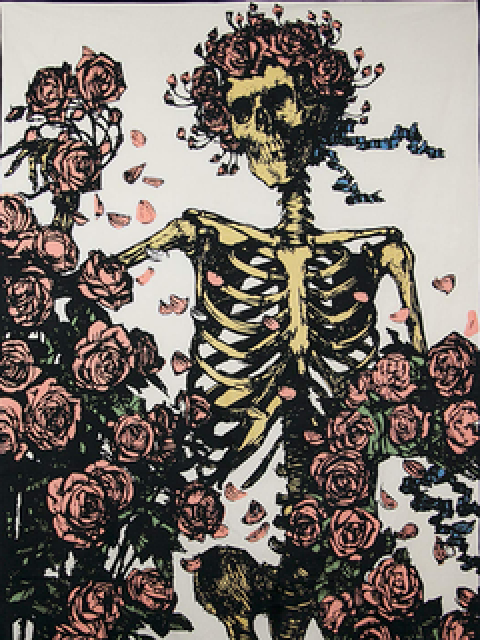

# Aura

Aura is a simple weather widget that runs on ESP32-2432S028R ILI9341 devices with a 2.8" screen. These devices are sometimes called a "CYD" or Cheap Yellow Display.

> **This is a fork of [Surrey-Homeware/Aura](https://github.com/Surrey-Homeware/Aura).** Huge thanks and credit to the Surrey-Homeware team for creating Aura: a delightfully polished little weather display, with a great case design, clear assembly instructions, and clean, approachable code that made forking it a pleasure. All the hard design and engineering work is theirs. If you want the original, supported project, go use and star theirs.
>
> This fork exists to customize Aura for personal use (a custom startup splash, a web installer) and to fix some bugs found along the way (crashes after changing language, UI freezes while waiting on NTP, a Wi-Fi reconnect that could hang forever, and bad geocode search results). Releases and a changelog are managed with [release-please](https://github.com/googleapis/release-please).

This is just the source code for the project. This project includes a case design and assembly instructions. The complete instructions are available
here: https://makerworld.com/en/models/1382304-aura-smart-weather-forecast-display

### Startup splash

On boot, Aura shows the Grateful Dead "Skeleton and Roses" artwork for 2 seconds before connecting to Wi-Fi. This is copyrighted artwork used without permission; remove it before reusing this code elsewhere. Preview (240x320 screen, 2x scale):

This copy is a photo of a tapestry print of that design, converted for LVGL (RGB565A8, 240x320, cropped to fill the screen) in `aura/image_grateful_dead.c`. The artwork is copyrighted and used here without permission.

#### About the artwork: Bertha and the Victorian print

The skeleton is known among Deadheads as **Bertha**. It began as a pen-and-ink plate by the British illustrator [Edmund J. Sullivan](https://en.wikipedia.org/wiki/E._J._Sullivan) (1869-1933) for a 1913 edition of Edward FitzGerald's translation of *The Rubaiyat of Omar Khayyam*. In 1966, San Francisco poster artists Alton Kelley and Stanley Mouse found the drawing in a library book and reworked it, in color, into a poster for a Grateful Dead show at the Avalon Ballroom. It reappeared on the band's 1971 live album, *Grateful Dead*, which fans call *Skull & Roses*. The nickname "Bertha" is usually credited to the song of that name, which opens that album, though the exact origin of the name is disputed.

I could not confirm which verse Sullivan's rose-crowned skeleton plate illustrates. The Morgan Library catalogs another Sullivan skeleton drawing for the quatrain below, so here it is as a stand-in (FitzGerald's translation, public domain):

> And we, that now make merry in the Room
> They left, and Summer dresses in new bloom,
> Ourselves must we beneath the Couch of Earth
> Descend, ourselves to make a Couch - for whom?

Sources: [Music Mascots Archive](https://musicmascotsarchive.com/mascot/bertha), [Danny Scope](https://dannyscopemusic.substack.com/p/we-that-now-make-merry-in-the-room), [Vinyl Connection](https://vinylconnection.com.au/2014/04/04/omar-and-the-dead/), [The Morgan Library](https://themorgan.org/node/39601), [Victorian Web](https://victorianweb.org/art/illustration/sullivan/rubaiyat.html).

### License

You can use the weather.ino code here under the terms of the GPL 3.0 license.

The icons are not included in that license. See "Thanks" below for details on the icons.

### How to compile:

1. Configure Arduino IDE 
    1. for "esp32" board with a device type of "ESP32 Dev Module" and
    1. set "Tools -> Partition Scheme" to "Huge App (3MB No OTA/1MB SPIFFS)"
1. Install the libraries below in Arduino IDE
1. Put the source code folders that are in this folder in ~/Documents/Arduino/
    1. Note the included config files for lvgl and TFT_eSPI need to be dropped in their respective folders
1. Install and run

### Libraries required to compile:

- ArduinoJson 7.4.1
- HttpClient 2.2.0
- TFT_eSPI 2.5.43_
- WifiManager 2.0.17
- XPT2046_Touchscreen 1.4
- lvgl 9.2.2

### Thanks & Credits

- Weather icons from https://github.com/mrdarrengriffin/google-weather-icons/tree/main/v2
- Thanks to [lvgl](https://lvgl.io/), a great library for UIs on ESP32 devices that made this much easier
- Thanks to [witnessmenow](https://github.com/witnessmenow/)'s [CYD Github repo](https://github.com/witnessmenow/ESP32-Cheap-Yellow-Display) for dev board reference information
- Double thanks to [witnessmenow](https://github.com/witnessmenow/) for the [ESP32 web flashing tutorial](https://github.com/witnessmenow/ESP-Web-Tools-Tutorial)
- Thanks to [Random Nerd Tutorials](https://randomnerdtutorials.com/) for helpful ESP32 / CYD information, especially with [setting up LVGL](https://randomnerdtutorials.com/esp32-cyd-lvgl-line-chart/)
- Thanks to these sweet libraries that made this possible:
	- [ArduinoJson](https://arduinojson.org/)
	- [HttpClient](https://github.com/amcewen/HttpClient)
	- [TFT_eSPI](https://github.com/Bodmer/TFT_eSPI)
	- [WifiManager](https://github.com/tzapu/WiFiManager)
	- [XPT2046_Touchscreen](https://github.com/PaulStoffregen/XPT2046_Touchscreen)
	- [lvgl](https://lvgl.io/)
